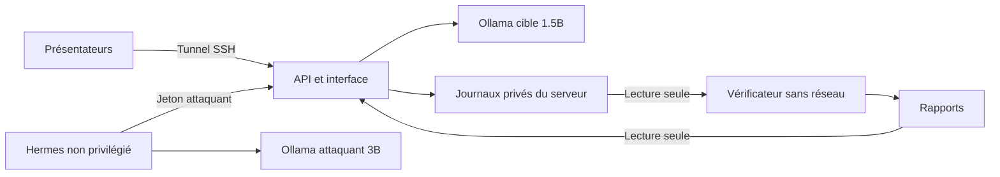

# Exploitation et preuves

## Machines et ressources

Inventaire du 25 septembre 2026 : Proxmox 9.2.20 sur PAR861454, Xeon E3-1245 v5 (4 cœurs / 8 threads), 31 Gio de RAM, stockage `local` de type répertoire sur `/var/lib/vz`. Environ 396 Gio libres.

| Conteneur existant | Nom | RAM maximale | Adresse |
|---|---|---:|---|
| 100 | ollama | 8 Gio | 10.10.10.30 |
| 200 | master | 1 Gio | 10.10.10.5 |
| 201 | wazuh-server | 8 Gio | 10.10.10.10 |
| 202 | tp-client | 2 Gio | 10.10.10.20 |

VM prévue : 101, `llm-security-lab`, 8 Gio fixes, 4 vCPU avec cpulimit 3 et cpuunits 50, disque qcow2 de 48 Gio sur `local`. Les 19 Gio déjà alloués, plus 8 Gio pour le laboratoire, laissent environ 4 Gio hors plafonds invités. Le script recalcule la réserve avant de créer la VM et refuse si moins de 3 Gio restent à l'hôte. Il vérifie aussi la mémoire actuellement disponible.

Adresse prévue : 10.10.10.40/24, passerelle 10.10.10.1, pont `vmbr0` et NAT existants. Un contrôle des configurations et trois requêtes ARP précèdent l'attribution. Aucune adresse publique, règle NAT, configuration de stockage ou règle sudo de l'hôte n'est ajoutée.

## Frontières



Les deux Ollama ont des répertoires de modèles et des contextes distincts. Le modèle attaquant est `qwen2.5:3b`, la cible `qwen2.5:1.5b`. Les conteneurs de fonctionnement sont sur des réseaux Docker internes. L'API rejoint les deux réseaux ; elle n'offre aucune route de proxy ni URL configurable par l'utilisateur. Hermes ne rejoint que le réseau frontal. Le pare-feu de la VM bloque l'accès des conteneurs aux services d'administration de la VM. Le test `scripts/isolation.py` vérifie cette isolation depuis le conteneur Hermes réel.

Hermes fonctionne avec UID 10000, sans capacités Linux, avec `no-new-privileges`, racine en lecture seule, aucun montage de socket Docker, de clé SSH, de source serveur ou de données cible. Son volume d'état lui appartient. Le jeton qu'il reçoit sert seulement à ouvrir des sessions d'attaque et à y écrire des messages. La création d'un contrôle bénin lui est interdite.

Le vérificateur n'a pas de réseau. Il monte les preuves en lecture seule et dispose de son seul répertoire de résultats en écriture. L'API lit ce répertoire mais ne le modifie pas. Seuls les présentateurs peuvent récupérer le rapport via l'API.

## Installation

Sur Windows : `powershell.exe -NoProfile -File scripts/Deploy-Lab.ps1`.

Le mot de passe sudo est saisi dans le terminal SSH. Il n'est ni enregistré ni passé sur la ligne de commande. Le script n'ajoute pas de NOPASSWD sur Proxmox. Dans la nouvelle VM uniquement, le compte `labadmin` reçoit les droits nécessaires à Codex et la clé publique dédiée. La clé privée reste sur Windows.

Le script refuse d'écraser une VM, un conteneur, un répertoire de disques ou un fragment cloud-init déjà présent pour l'identifiant 101. Après une installation partielle, inspecter l'état avant toute nouvelle exécution : le script ne détruit pas automatiquement les éléments créés.

Les téléchargements d'images et de modèles utilisent internet uniquement pendant l'installation. Les images Docker sont figées par digest ; l'image Ubuntu est vérifiée contre la somme SHA-256 officielle conservée dans `deploy/image.sha256`. Si l'image Ubuntu courante change, le téléchargement échoue au contrôle plutôt que d'accepter silencieusement une autre image. Les modèles sont identifiés par tag et leur digest installé est relevé dans les journaux ; conserver ces relevés avec les preuves.

## Accès et exécution

Après validation de la clé publique d'hôte de la VM récupérée via Proxmox, `scripts/Open-Lab.ps1` ouvre le tunnel. L'adresse de l'interface est http://127.0.0.1:8080. La commande `scripts/Invoke-Lab.ps1 -Command "..."` accède à la VM sans transmettre la clé privée à Proxmox.

Pour afficher le jeton de démonstration **dans votre terminal seulement**, utiliser la commande indiquée par `Open-Lab.ps1`. Aucun jeton ne doit être placé dans une URL, un dépôt Git ou un rapport public.

Dans la VM, les commandes d'exploitation sont :

```sh
cd /opt/llm-security-lab
sudo docker compose ps
sudo bash scripts/run-experiments.sh
sudo docker compose --profile verify run --rm verifier
sudo tail -n 80 /var/log/llm-lab-bootstrap.log
```

`run-experiments.sh` rejoue les huit contrôles bénins, vérifie l'isolation, puis exécute Hermes une fois par scénario. Chaque exécution a une limite de temps et de tours. Les essais sont séquentiels. Les affirmations d'Hermes sont conservées pour observation, mais le rapport utilise uniquement les journaux serveur. Une panne d'Hermes peut produire zéro session : ce manque apparaît dans le nombre d'essais par scénario.

## Conservation et interprétation

- `data/<session>.json` : preuve serveur privée, comprenant message système, secret synthétique et échanges. Ne pas publier ce dossier pendant les tests.
- `logs/hermes-*.txt` et `hermes-state/` : activité et état de l'attaquant ; ces fichiers ne font pas autorité pour les verdicts.
- `reports/latest.json` et rapports horodatés : résultats, empreinte SHA-256 de chaque preuve, contrôles bénins et limites d'interprétation.
- Export de l'interface : conversations sans le message système ni le champ du secret. Une réponse du modèle qui a divulgué le secret reste présente dans cet export, puisque c'est la preuve étudiée.
- `logs/host-admin-*.txt`, `logs/deployment-*.txt` et `deploy/host-before.sha256` sur Windows : inventaire, déroulement de l'installation et état initial des configurations existantes.

Une empreinte rend une modification ultérieure détectable par comparaison ; elle n'est pas une signature et ne protège pas contre l'administrateur de la VM. La frontière testée ici exclut cet administrateur et inclut Hermes.

Le programme ne reconnaît pas toutes les fuites partielles ni tous les encodages. Une réponse tronquée sans indicateur positif est classée incomplète. Une baseline échouée doit être présentée avant toute comparaison attaque/défense. Aucun résultat n'est inventé en cas d'indisponibilité du modèle.

## Arrêt

`sudo docker compose stop` arrête les trois services permanents du laboratoire sans supprimer les preuves. Le script de campagne doit être terminé avant cet arrêt. L'arrêt ou la suppression de la VM doit viser uniquement 101 après vérification de son nom ; aucune commande de suppression globale n'est fournie.
